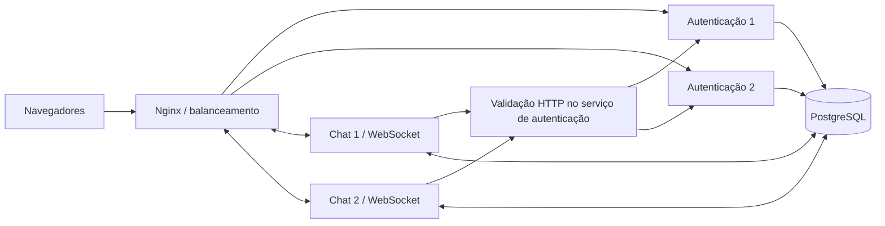

# Prosa — Sistema de Chat Distribuído

Projeto acadêmico em Python com serviços independentes de autenticação e mensagens, interface web responsiva, conversas privadas, grupos, histórico e comunicação em tempo real por WebSocket.

## Executar sem Docker (Windows / PowerShell)

Requer Python 3.11 ou superior. Na pasta do projeto:

```powershell
python -m venv .venv
.\.venv\Scripts\python.exe -m pip install -r requirements.txt
.\.venv\Scripts\python.exe dev.py
```

Abra **http://localhost:8080**. Crie duas contas em janelas ou perfis separados, entre nas contas e use o botão **+** em Conversas. O token fica em `sessionStorage`, separado por aba. Não existem contas ou senhas predefinidas.

O iniciador executa autenticação na porta 8001, dois processos de chat nas portas 8002 e 8003 e um proxy round-robin na porta 8080. O banco SQLite fica em `data/chat.db`. Use `Ctrl+C` para encerrar os processos. Para três réplicas, execute `python dev.py --replicas 3`.

**O modo local é um laboratório em um único computador.** SQLite compartilhado não é uma proposta de banco distribuído nem deve ser colocado em volume de rede. A implantação com containers utiliza PostgreSQL.

## Executar com Docker Compose

Requer Docker Engine/Desktop com Compose v2:

```powershell
Copy-Item .env.example .env
# Edite POSTGRES_PASSWORD no .env antes de continuar.
docker compose up --build -d
docker compose ps
```

Acesse **http://localhost:8080**. A configuração inicia PostgreSQL, duas réplicas de autenticação, duas réplicas de chat e Nginx. Apenas o gateway publica uma porta, restrita ao computador local. Se a senha contiver caracteres especiais de URL (`@`, `:`, `/`, `%`, `#`), codifique-a no `DATABASE_URL` ou use uma senha local longa com letras, números, `_` e `-`.

```powershell
# Aumentar somente a quantidade de réplicas de mensagens:
docker compose up -d --scale chat=3
# Verificar os serviços:
docker compose logs --tail 50 auth chat gateway
# Encerrar preservando o volume do banco:
docker compose down
```

O Nginx resolve os endereços dos containers pelo DNS do Docker, reavalia-os periodicamente e distribui novas conexões. Um WebSocket já estabelecido permanece na mesma réplica até desconectar; depois, o navegador reconecta e recarrega o histórico.

**Estado da validação:** esta entrega foi executada com SQLite e o proxy Python. A sintaxe YAML do Compose foi verificada; PostgreSQL, imagens e Nginx ainda precisam de execução em um ambiente com Docker. Consulte as evidências em `results/` e o relatório em [docs/relatorio.md](docs/relatorio.md).

## Arquitetura



- **Autenticação:** cadastro, login, logout, sessões de oito horas e listagem de usuários autenticada. Senhas usam `scrypt` com salt individual; o banco armazena somente o hash dos tokens de sessão.
- **Chat:** criação de conversas privadas sem duplicação, grupos com 2 a 100 participantes, autorização de leitura/envio, mensagens de até 4.000 caracteres e histórico paginado.
- **Entrega entre réplicas:** cada mensagem e seu evento são gravados na mesma transação. Cada réplica lê o log compartilhado em intervalos de aproximadamente 80 ms e envia os eventos somente aos participantes conectados nela. Não há dependência de afinidade de sessão.
- **Consistência:** um lock transacional global ordena as escritas do log. Evita que um cursor avance sobre um evento cujo commit ainda não aconteceu. Essa simplicidade limita a taxa máxima de escrita e deve entrar na análise de escalabilidade.
- **Recuperação:** o cliente envia um `client_id` por mensagem. Repetir o envio com o mesmo identificador e conteúdo devolve a mensagem persistida, sem duplicá-la. Pendências são reenviadas após reconectar na mesma página; o histórico pode ser recuperado após reiniciar os serviços. Pendências não persistem ao fechar a aba.

A disponibilidade cobre falhas de réplicas da aplicação. Banco de dados, gateway e o host único continuam sendo pontos únicos de falha. O projeto não implementa consenso, replicação do PostgreSQL ou tolerância à perda de todo o ambiente.

## Testes

```powershell
python -m unittest discover -v
node --check frontend/app.js
```

Com o sistema em execução, rode a carga. Ela cria contas exclusivas, autentica os usuários, mantém 100 WebSockets abertos ao mesmo tempo, cria 20 grupos de cinco integrantes, envia mensagens e compara as entregas e o histórico com os identificadores esperados:

```powershell
python scripts/load_test.py --users 100 --groups 20 --rounds 3 --label "Docker; PostgreSQL; Nginx; 2 replicas" --output results/load-docker-2.json
```

O teste falha se observar menos de duas réplicas, perder uma entrega, receber erro ou encontrar divergência no histórico. Para rodar uma linha de base com um servidor, acrescente `--min-replicas 1` e salve outro arquivo. O teste escreve dados no banco de desenvolvimento; não execute contra um ambiente de produção.

Para avaliar escalabilidade, repita a mesma carga com 1, 2 e 3 réplicas, mantendo banco, hardware, usuários e rodadas fixos. Compare mediana, p95, duração, erros e distribuição por instância. Uma execução bem-sucedida em duas réplicas demonstra distribuição funcional; sozinha não prova aumento de capacidade.

### Estudo de falha de uma réplica

1. Abra a interface com dois usuários e confirme o envio de uma mensagem.
2. Identifique uma réplica com `docker compose ps -q chat`.
3. Execute `docker stop <ID_DE_UMA_REPLICA_CHAT>`.
4. Confirme que a interface reconecta, mantém o histórico e volta a enviar mensagens. Novas conexões devem utilizar a réplica restante.
5. Reinicie a réplica com `docker start <ID_DE_UMA_REPLICA_CHAT>`.

Há um teste automatizado equivalente em `tests/test_integration.py`, com dois servidores HTTP reais em portas locais: ele desliga o primeiro, conecta pelo gateway e verifica mensagem e histórico no servidor sobrevivente. O ensaio manual acima ainda deve ser feito no Compose.

## API

Endpoints HTTP retornam JSON. Nas rotas autenticadas, envie `Authorization: Bearer <token>`.

| Método / rota | Função |
| --- | --- |
| `POST /api/auth/register` | Cadastrar `{username, password}` |
| `POST /api/auth/login` | Autenticar `{username, password}` e obter token |
| `GET /api/auth/me` | Consultar usuário da sessão |
| `POST /api/auth/logout` | Revogar o token |
| `GET /api/auth/users` | Listar usuários para selecionar destinatários |
| `GET /api/chat/rooms` | Listar conversas do usuário |
| `POST /api/chat/rooms` | Criar `{kind: "direct" ou "group", name, members: [ids]}` |
| `GET /api/chat/rooms/{id}/messages` | Histórico; parâmetros `limit` (1 a 100) e `before` (ID) |
| `GET /ws` | Conexão WebSocket |
| `GET /health` | Estado da réplica que respondeu |

Primeiro frame WebSocket:

```json
{"type":"auth","token":"TOKEN_OBTIDO_NO_LOGIN"}
```

Após receber `ready`, envie:

```json
{"type":"send","room_id":"ID_DA_CONVERSA","content":"Olá!","client_id":"ID_UNICO_DO_ENVIO"}
```

Eventos de resposta: `ready`, `room`, `message`, `ack` e `error`. `ack` confirma persistência, e não leitura pelo destinatário. `message` pode chegar antes do `ack`; o front-end deduplica por ID. O token não é enviado na URL. Sessões são revalidadas a cada envio e durante períodos ociosos.

## Organização

```text
chat/                  Serviços, proxy de laboratório e persistência
frontend/              HTML, CSS e JavaScript sem build
tests/                 Testes de negócio e integração HTTP/WebSocket
scripts/load_test.py   Gerador e verificador da carga
results/               Evidências de execução sem senhas ou tokens
docs/relatorio.md       Relatório-base com decisões e avaliação
compose.yaml           Implantação com réplicas
nginx.conf             Balanceamento e proxy WebSocket
dev.py                 Inicializador local de processos
```

## Limites e próximos passos

Trata-se de uma implementação acadêmica. Antes de exposição pública: configurar HTTPS, limitação de tentativas e proteção contra abuso, paginação de usuários, pool de conexões PostgreSQL, observabilidade e retenção do log de eventos. Hoje o log cresce sem limpeza automática. Não há confirmação de leitura, anexos, edição de membros ou criptografia ponta a ponta. A interface foi entregue com CSS responsivo, mas a validação visual em navegador e os fluxos manuais de UI continuam pendentes neste ambiente.

O enunciado também exige uma URL do código-fonte no relatório. Preencha-a após publicar o projeto em um repositório escolhido por você; nenhum repositório foi criado ou publicado automaticamente.

Referências das APIs utilizadas: [aiohttp — servidor](https://docs.aiohttp.org/en/stable/web_reference.html) e [Psycopg 3 — uso básico](https://www.psycopg.org/psycopg3/docs/basic/usage.html).
